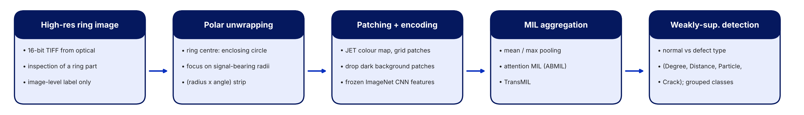
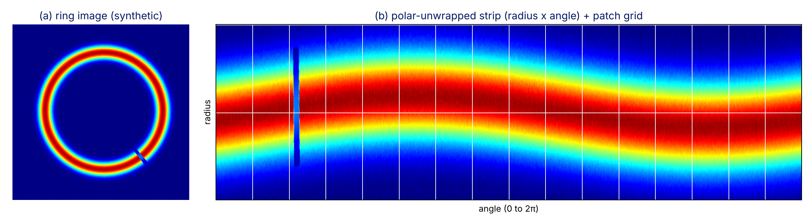

# RingDefect-MIL: Weakly Supervised Defect Detection on Ring-Beam Inspection Images via Polar Unwrapping and Multiple Instance Learning
This repository contains the defect-detection code developed for the AI-converged intelligent optical inspection project for 3D semiconductors (Blue Tile Lab × ETRI × KAIST, 2025).

<p align="center">
    
    
    
</p>

<p align="center">
    🖇️&nbsp;<a href="#-overview">Overview</a>
    | 👀&nbsp;<a href="#-installation">Installation</a>
    | 📚&nbsp;<a href="#-dataset">Dataset</a>
    | 🚀&nbsp;<a href="#-training">Training</a>
    | 🙏&nbsp;<a href="#-acknowledgements">Acknowledgements</a>
</p>

## 🖇️ Overview
Ring-beam optical inspection produces **high-resolution, ring-shaped (annular) images** in which a defect occupies only a tiny region, and only **image-level** labels (normal or defect type) are available. Feeding such images directly to a vision model wastes most of the input on background, distorts the ring when resized, and leaves no pixel-level supervision.

**RingDefect-MIL** makes these images learnable for standard vision encoders by **unwrapping the ring into a rectangular strip (polarization)**, splitting it into **patches**, and classifying each image as a bag of patches with **Multiple Instance Learning (MIL)**. This way, defect detection is trained with weak (image-level) supervision only.

<p align="center">
  
</p>

**RingDefect-MIL** consists of three main components:
1. **Polar unwrapping**: The ring centre is estimated from the minimum enclosing circle of the brightest region. A coarse polar resampling locates the band of radii that carries signal, and the final resampling over that band turns the ring into a (radius × angle) strip ([`polar.py`](polar.py)).
2. **Patching and encoding**: The strip is colour-mapped, split into grid patches, and dark background patches are discarded. Each remaining patch is encoded by a frozen ImageNet CNN (ResNet-18/50, EfficientNet-B0, MobileNet-V3), and every image is stored as a bag of patch features ([`extract_features.py`](extract_features.py)).
3. **MIL aggregation**: Patch features are aggregated by mean/max pooling, attention-based MIL (ABMIL, gated attention), or TransMIL, and the image is classified as normal or as a defect type (Degree, Distance, Particle, Crack). Defect types can be grouped, e.g. `Particle+Crack` ([`model.py`](model.py)).

<p align="center">
  
  <br><em>Polar unwrapping on a synthetic ring with an artificial crack: the defect becomes a localized patch in a rectangular strip.</em>
</p>

### Highlights
- Geometry-aware preprocessing: the ring is unwrapped instead of resized, so a defect keeps its resolution and orientation regardless of where it lies on the ring.
- Weak supervision only: image-level labels are enough, and patch-level attention indicates where the defect is.
- Data-efficient: frozen encoders plus a light MIL head can be trained with a fixed small number of samples per class (`--split_method fixed`).
- Flexible label sets: binary (normal vs. one defect) or grouped multi-defect settings are given directly on the command line.

## 👀 Installation
We used Python 3.10.
```
# Create and activate conda environment
conda create -n ringmil python=3.10
conda activate ringmil
```
Install the required packages:
```
pip install -r requirements.txt
```

## 📚 Dataset
The inspection images belong to the project partners and are **not** included. Arrange your 16-bit TIFF images with one folder per class:
```
dataset/
├── Ref/        # normal
├── Degree/
├── Distance/
├── Particle/
└── Crack/
```

## 🚀 Training
**Step 1. Patch-feature extraction** with polar unwrapping (saved under `features/polar/<encoder>`):
```
python extract_features.py --data_dir dataset \
  --classes Ref Degree Distance Particle Crack \
  --crop --encoder resnet18 \
  --use_polar --r_bins 512 --s_bins 1024 --signal_ratio 0.2
```
Omit `--use_polar` to extract patches from the Cartesian (cropped) image instead (saved under `features/<encoder>`).

**Step 2. MIL training and evaluation**:
```
# normal vs. one defect type
python main.py --features_dir features/polar/resnet18 --method patch --pooling transmil --classes Ref Degree

# normal vs. grouped defects, stratified split
python main.py --features_dir features/polar/resnet18 --method patch --pooling transmil \
  --classes Ref Particle+Crack --split_method ratio

# few-shot setting: 40 training bags per class
python main.py --features_dir features/polar/resnet18 --method patch --pooling abmil \
  --classes Ref Particle+Crack --split_method fixed --train_samples_per_class 40
```
`--pooling` accepts `mean`, `max`, `abmil`, or `transmil`. Checkpoints, TensorBoard logs, a confusion matrix, and `summary.json` (including test accuracy) are written to `--exp_dir` (default `./experiments`).

## 🙏 Acknowledgements
This work was carried out in the 2025 AI global big-tech development program with **Blue Tile Lab** and **ETRI**, as part of the KAIST team. The MIL heads follow **ABMIL** (Ilse et al., 2018) and **TransMIL** (Shao et al., 2021). The implementation builds on **PyTorch**, **torchvision**, **OpenCV**, and **tifffile**.

## Notice
Inspection data, partner documents, and trained weights are proprietary and not distributed.
